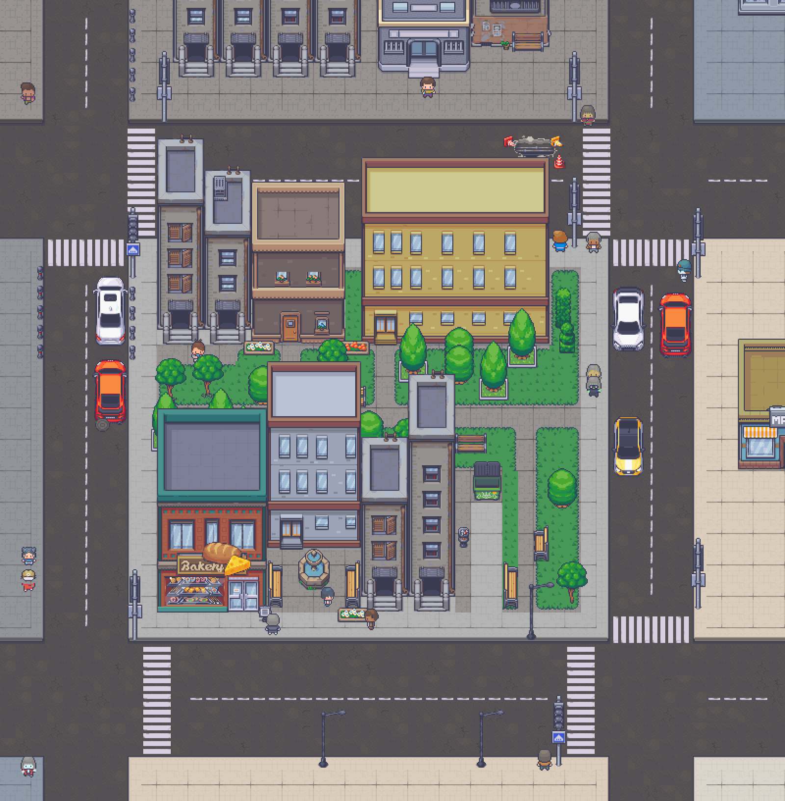
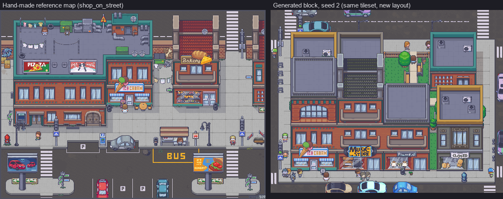
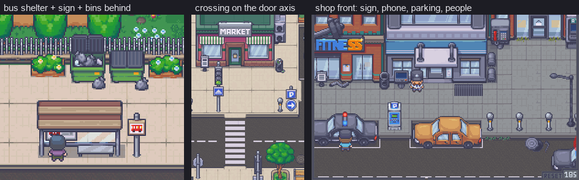
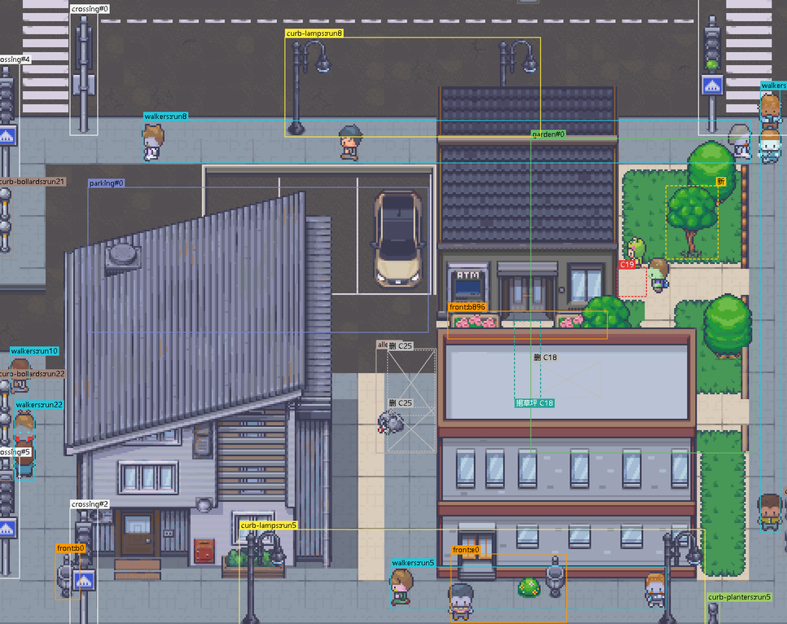
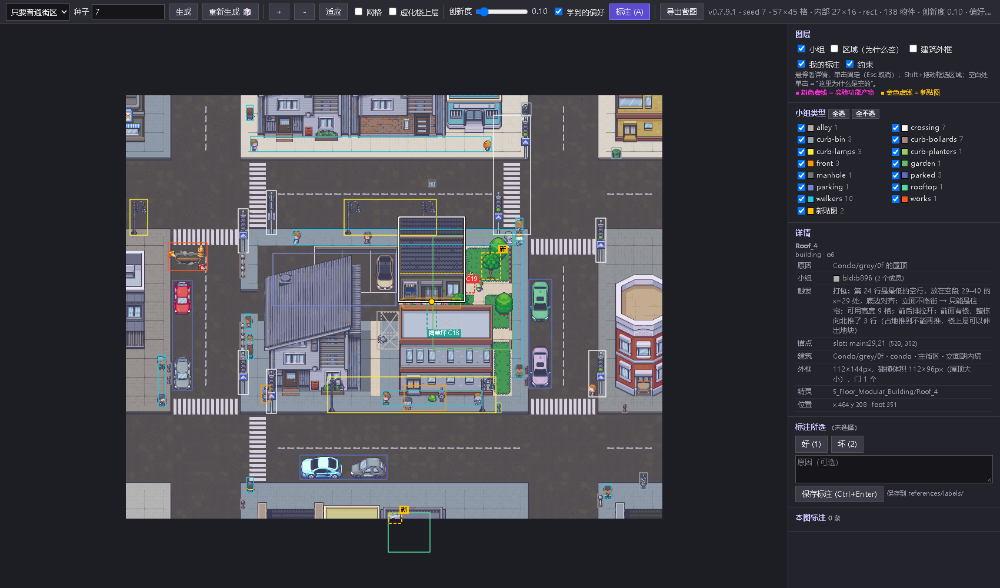
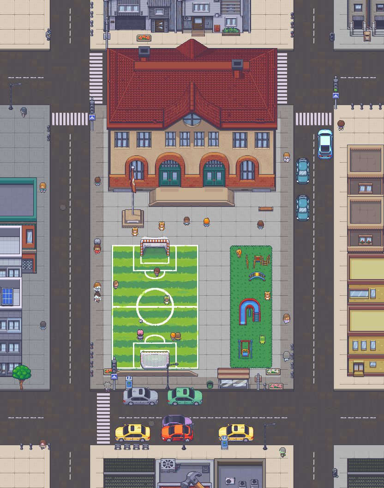
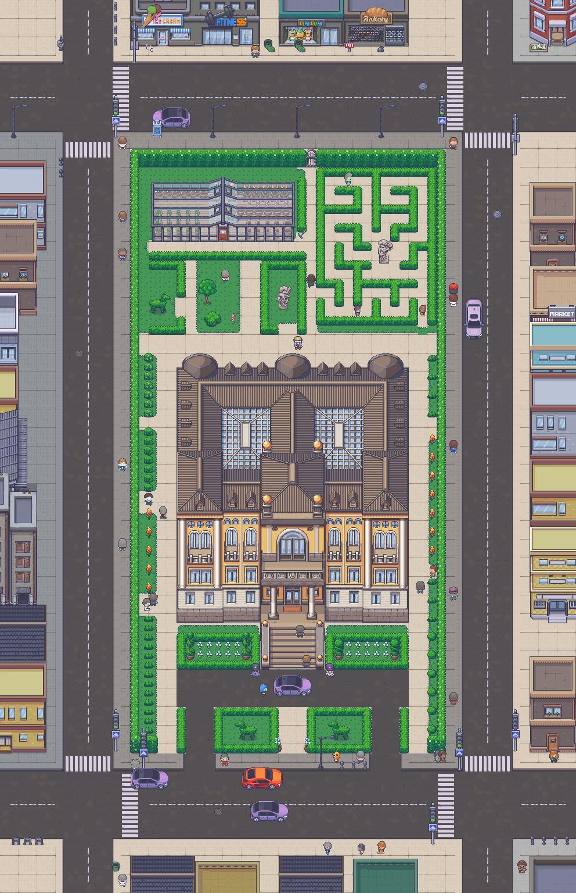
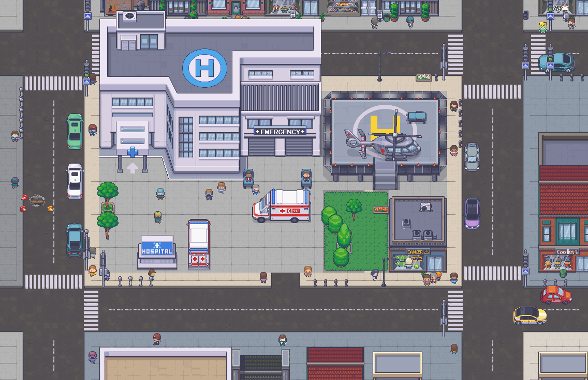
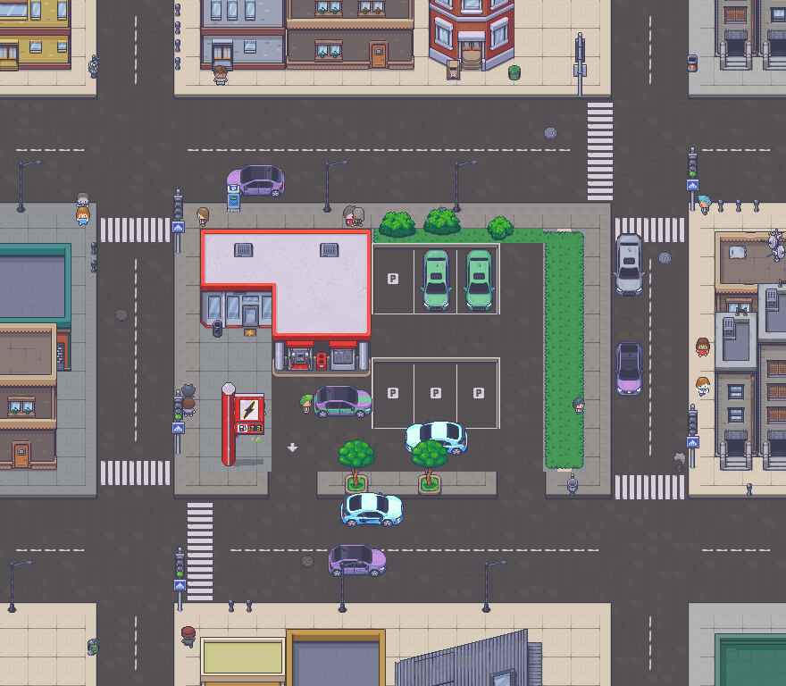

# City Block Generator

Procedural pixel-art city blocks that look hand-made. A seed-driven, rule-based generator (TypeScript, viewed in Phaser 3) calibrated on 46 hand-built reference maps, where every placed object can say why it is there.

[中文说明](README.zh-CN.md)



## What it does

- **One block per seed, with its surroundings.** Roads, sidewalks, buildings packed from modular pieces, yards and parking, shop fronts, bus stops, cars and pedestrians. The same seed always gives the same picture; different seeds differ clearly.
- **Objects come in groups with a reason.** A bus stop is a shelter, a sign, a waiting person and a bin; a crossing lines up with a door. The annotation layer shows every group and explains empty space too.
- **Checked, not decorated.** 25 declarative constraints audit each scene and repair it by deleting or downgrading, never by adding more.
- **Learns from your verdicts.** Good / bad labels made in the viewer become preference multipliers on the generator's decisions (Bradley-Terry). A novelty slider favours sprites the reference maps rarely used.
- **No neural network.** The reference maps were reverse-engineered into scene JSON with Python, and their statistics calibrated hand-written rules. The analysis tools and the generator share one scene format.





*Left: the kind of detail the generator is calibrated on, from the hand-made reference maps.*

## Quick start

Prerequisites: Node 24 and npm; Python 3.12 and [uv](https://docs.astral.sh/uv/) only for the Python tools; Microsoft Edge only for scripted screenshots. The tileset must be at `<repo>/assets/` (it is not part of this repository and is assumed to be provided separately, see [assets/README.md](assets/README.md)).

```sh
# 1. point the viewer at the tileset (once)
cd app/public && mklink /J assets ..\..\assets          # Windows cmd
ln -s ../../assets app/public/assets                     # macOS / Linux, from the repo root

# 2. install and run the viewer
cd app && npm ci
npx vite                                                 # open http://localhost:5173/?seed=7
```

In the viewer: `R` new seed, `A` annotation layer, `G` see-through building tops, `E` export PNG + JSON, `F` fit to window. URL parameters: `seed=7`, `d=school|hospital|police|fire|mall|hotel|gas|palace|none`, `nov=0.3` novelty.

Headless generation and rendering:

```sh
cd app && npx tsx scripts/batch.ts ../work/gen 1..12 --d=gas   # scene JSON per seed (omit --d for plain blocks)
cd tools && uv sync && uv run python render_generated.py ../work/gen/scene_gas_1.json --scale 1
```

Checks: `cd app && npm test` (55 tests, about a minute) and `npx tsc --noEmit`. Regression over 200 fixed seeds: `npx tsx scripts/regress.ts snapshot-par ../work/regress/base --jobs 8`, change something, snapshot again, then `npx tsx scripts/regress.ts compare ../work/regress/base ../work/regress/new`.

## Explainable output

Press `A` in the viewer. Every object is boxed with its group id, violations and repairs are marked, and the side panel tells you why a thing (or an empty spot) is where it is.





Clicking an object and pressing `1` (good) or `2` (bad) writes a label to `references/labels/`. Labels are replayed as regression tests and train the preference table.

## Special districts

Besides plain blocks, a seed can be a campus around a landmark: school, hospital, police station, fire station, shopping mall, hotel, gas station, or a palace garden. Pick one from the viewer's menu or `d=`; by default one seed in five becomes a district.

| School (`d=school`) | Palace garden (`d=palace`) |
|---|---|
|  |  |

| Hospital (`d=hospital`) | Gas station (`d=gas`) |
|---|---|
|  |  |

## How it works

```
46 reference maps ──(Python: tools/)──► scene JSON ──► statistics ──► calibrated rules
                                                                          │
seed ──► layout ► buildings ► yards ► street vignettes ► explain ──► scene JSON ──► constraints audit + repair
                                                                          │                    │
                                                      Phaser viewer ◄─────┘        good / bad labels ──► preferences
```

Each subsystem draws from its own named random stream, so changing one part of the generator leaves the rest of a seed's picture untouched. Details: [app/src/gen/README.md](app/src/gen/README.md) for the pipeline, [docs/reports/methodology.md](docs/reports/methodology.md) for the method (Chinese).

## Repository map

Each folder has its own README that explains every file in it.

| Folder | What is in it |
|---|---|
| [app/](app/README.md) | Vite + Phaser 3 viewer, the headless scripts (batch, regression, screenshots, preference training). |
| [app/src/gen/](app/src/gen/README.md) | The generator: layout, packing, districts, vignettes, constraints, learning. |
| [app/src/world/](app/src/world/README.md) | City mode's world layer: zones, roads, blocks, world ground, block windows, region export. |
| [tools/](tools/README.md) | Python analysis of the reference maps, asset metadata export, headless render and evaluation. |
| [docs/](docs/README.md) | Brief, decision log, progress, experiment register, analysis and version reports (Chinese). |
| [references/](references/README.md) | The user's labels and archived A/B choices (JSON). The reference maps themselves are not published. |
| [assets/](assets/README.md) | Expected layout of the tileset. Not part of the repository. |
| [work/](work/README.md) | Scratch output of every script. Gitignored. |
| [archive/](archive/ab/README.md) | Retired A/B comparison feature, kept out of the build (Chinese). |

## Status

Version 0.8.0 (November 2026). The generator produces a single block with neighbouring blocks for context. v0.8.0 adds a world layer (`app/src/world/`) that lays out roads and blocks and generates each block in a window, exported as one large picture by `app/scripts/cityshot.ts`; a streamed, explorable city is the v1.0.0 goal. Experiments exp-01 and exp-03 to exp-09 have been adopted into the default output; exp-02 was dropped. Design documents, decision log and reports are written in Chinese.

## Credits

This project uses art assets by **LimeZu**:
- [Modern Exteriors](https://limezu.itch.io/modernexteriors) by LimeZu

These assets are **not** covered by this project's open source license.
They are used under LimeZu's own license, which allows use in commercial and
non-commercial projects but does not allow redistributing or reselling the
assets on their own. See [`assets/Modern_Exteriors_License.pdf`](assets/Modern_Exteriors_License.pdf)
for the full terms.

If you want to use these assets to reproduce your own version, you'll need to purchase it yourself, and drop in the 16x16 version in subfolders in assets\, named `exteriors` for building blocks, and `exterior_autotiles` for autotiles assets.

## License

The project code is licensed under the GNU GPLv3. See the LICENSE file for details. 

The tileset in `assets/` and the hand-made reference maps in `references/` are third-party work and are not included in this repository; the README figures contain crops of them for illustration only. You can see a full version of them at [sourse](https://limezu.itch.io/modernexteriors)
