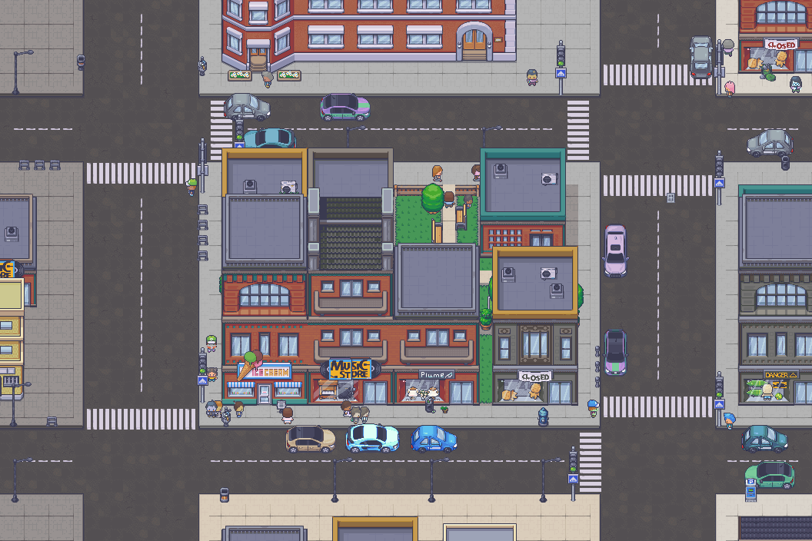
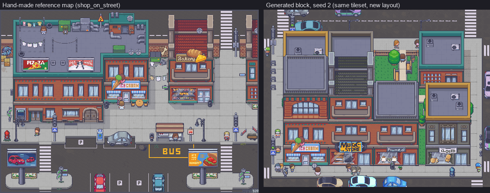
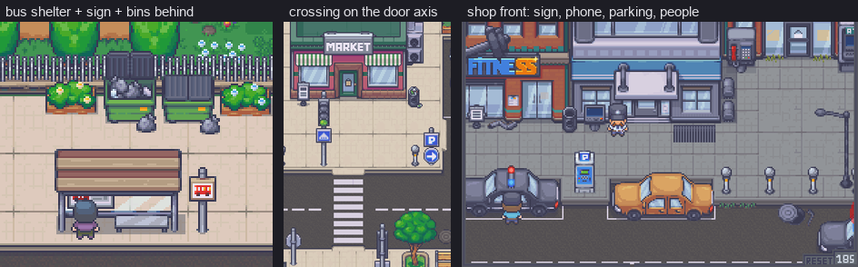
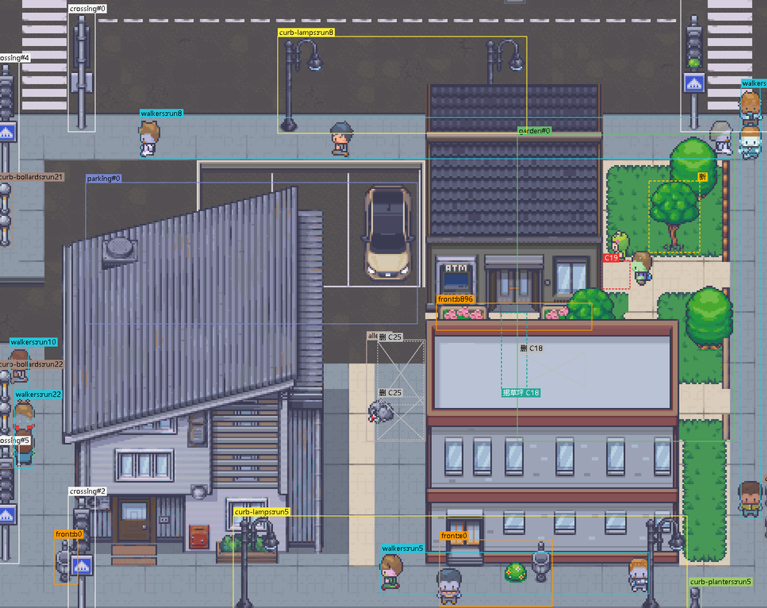
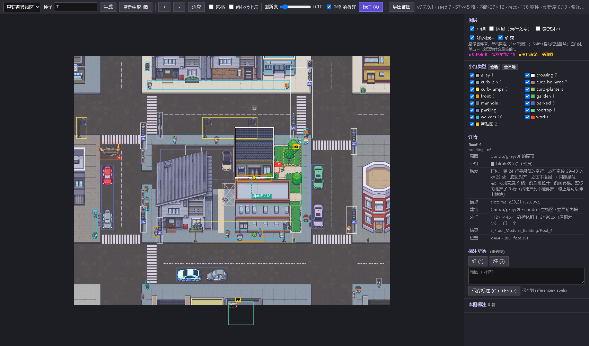
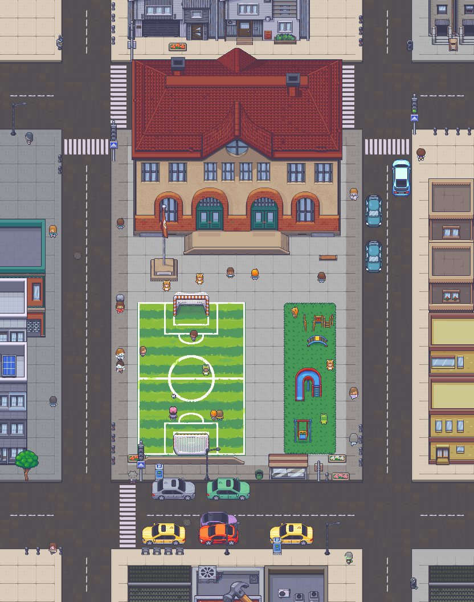
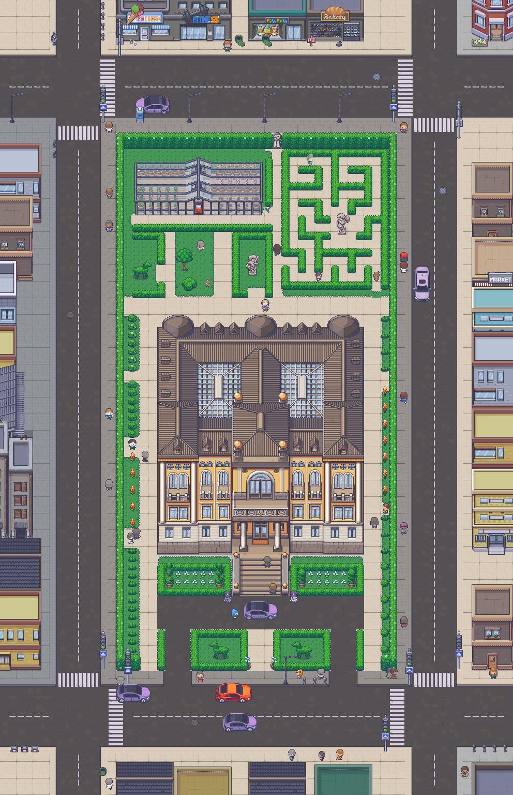
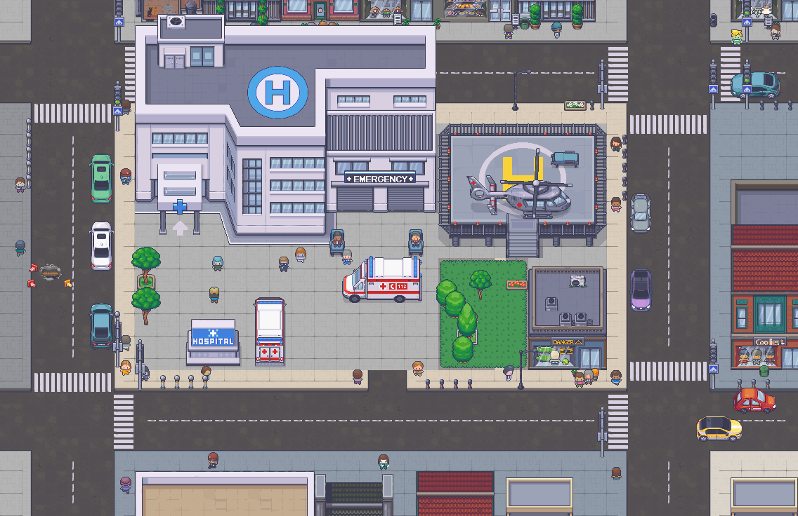
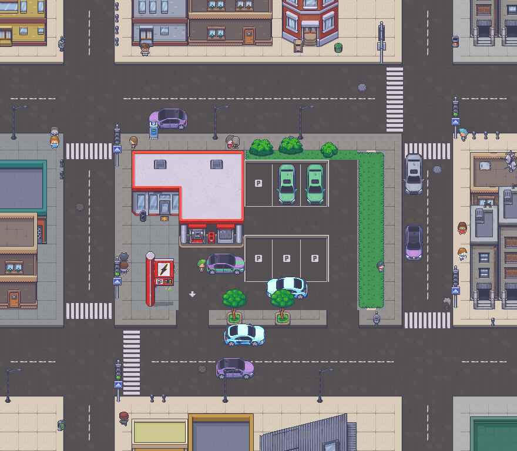

# 城市街区生成器

程序化生成像手工拼出来的像素风城市街区。由种子驱动的规则生成器（TypeScript，用 Phaser 3 查看），以 46 张手工拼制的参考地图校准，每个放下去的物件都能说出自己为什么在那里。

[English](README.md)



## 它做什么

- **一个种子一个街区，连同周围的环境。** 道路、人行道、由模块拼成的楼、内院和停车场、店门口、公交站、车和行人。同一种子永远得到同一张图，不同种子之间差异明显。
- **物件成组出现，各有理由。** 公交站是候车亭、站牌、等车的人和垃圾桶；人行横道对准店门。标注层显示每一个小组，也解释每一块刻意留空的地方。
- **先检查，不堆砌。** 25 条声明式约束审查每一张场景，修复只做删除或降级，从不往里补东西。
- **从你的判断中学习。** 在查看器里标的好 / 坏标注，变成生成器各个决策上的偏好乘子（Bradley-Terry）。创新度滑块让参考图里少用的素材更容易出现。
- **没有神经网络。** 参考图先用 Python 反解析成场景 JSON，用统计出来的数字校准手写规则。分析工具和生成器共用同一种场景格式。





*参考图里的这类细节，就是生成器校准的目标。*

## 快速开始

前置条件：Node 24 与 npm；Python 3.12 与 [uv](https://docs.astral.sh/uv/)（只有 Python 工具需要）；Microsoft Edge（只有脚本截图需要）。素材包须放在 `<repo>/assets/`（不包含在本仓库中，假定另行提供，见 [assets/README.md](assets/README.md)）。

```sh
# 1. 让查看器找到素材（只做一次）
cd app/public && mklink /J assets ..\..\assets          # Windows cmd
ln -s ../../assets app/public/assets                     # macOS / Linux，在仓库根目录执行

# 2. 安装并启动查看器
cd app && npm ci
npx vite                                                 # 打开 http://localhost:5173/?seed=7
```

查看器里：`R` 换种子，`A` 标注层，`G` 虚化楼上层，`E` 导出 PNG 和 JSON，`F` 适应窗口。URL 参数：`seed=7`，`d=school|hospital|police|fire|mall|hotel|gas|palace|none`，`nov=0.3` 创新度。

不开浏览器生成并渲染：

```sh
cd app && npx tsx scripts/batch.ts ../work/gen 1..12 --d=gas   # 每个种子一个场景 JSON（不加 --d 就是普通街区）
cd tools && uv sync && uv run python render_generated.py ../work/gen/scene_gas_1.json --scale 1
```

检查：`cd app && npm test`（55 项测试，约 1 分钟）和 `npx tsc --noEmit`。200 个固定种子的回归：`npx tsx scripts/regress.ts snapshot-par ../work/regress/base --jobs 8`，改完东西再拍一次，然后 `npx tsx scripts/regress.ts compare ../work/regress/base ../work/regress/new`。

## 可解释的产出

在查看器里按 `A`。每个物件都框出所属小组，违规和修复都有标记，侧栏告诉你一个东西（或一块空地）为什么在那里。





点选一个物件后按 `1`（好）或 `2`（坏），标注会写入 `references/labels/`。标注既作为回归测试回放，也用来训练偏好表。

## 特色街区

除了普通街区，一个种子也可以是围绕地标的园区：学校、医院、警察局、消防站、购物中心、酒店、加油站，或者宫殿花园。在查看器菜单或 `d=` 里选择；默认每五个种子有一个变成特色街区。

| 学校（`d=school`） | 宫殿花园（`d=palace`） |
|---|---|
|  |  |

| 医院（`d=hospital`） | 加油站（`d=gas`） |
|---|---|
|  |  |

## 原理

```
46 张参考图 ──(Python: tools/)──► 场景 JSON ──► 统计 ──► 校准后的规则
                                                              │
种子 ──► 布局 ► 建筑 ► 内院 ► 街面小景 ► 解释 ──► 场景 JSON ──► 约束审查 + 修复
                                                              │                 │
                                            Phaser 查看器 ◄───┘      好 / 坏标注 ──► 偏好
```

每个子系统从自己命名的随机流取数，所以改动生成器的一部分不会打乱同一种子画面的其余部分。细节见 [app/src/gen/README.md](app/src/gen/README.md)（管线）和 [docs/reports/methodology.md](docs/reports/methodology.md)（方法）。

## 仓库地图

每个文件夹都有自己的 README，解释其中每个文件的用途。

| 文件夹 | 内容 |
|---|---|
| [app/](app/README.md) | Vite + Phaser 3 查看器，以及无头脚本（批量生成、回归、截图、偏好训练）。 |
| [app/src/gen/](app/src/gen/README.md) | 生成器本体：布局、打包、特色街区、街面小景、约束、学习。 |
| [app/src/world/](app/src/world/README.md) | 城市模式的世界层：分区、路网、街区、世界地面、街区窗口、区域导出。 |
| [tools/](tools/README.md) | Python 参考图分析、素材元数据导出、无头渲染和评估。 |
| [docs/](docs/README.md) | 需求、决策记录、进度、实验登记、分析和各版本报告。 |
| [references/](references/README.md) | 用户的标注和归档的 A/B 选择（JSON）。参考图本身不公开。 |
| [assets/](assets/README.md) | 素材包的预期目录结构。不包含在仓库中。 |
| [work/](work/README.md) | 所有脚本的中间产物。已被 git 忽略。 |
| [archive/](archive/ab/README.md) | 已停用的 A/B 比较功能，不参与编译。 |

## 现状

版本 0.8.0（2026 年 11 月）。生成器产出单个街区，带周围街区作为环境。v0.8.0 加了世界层（`app/src/world/`）：铺好路网和街区，每个街区在自己的窗口里生成，`app/scripts/cityshot.ts` 导出成一张大图；可以漫游的流式城市是 v1.0.0 的目标。实验 exp-01 和 exp-03 到 exp-09 都已转正进入默认输出，exp-02 已废弃。

## 许可

代码许可尚未决定。`assets/` 中的素材包和 `references/` 中的手工参考图是第三方作品，不包含在本仓库中；README 里的图片只为说明而截取了其中的局部。
